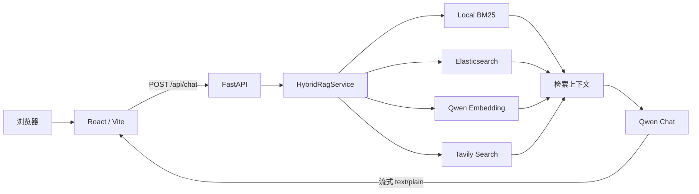

# Insurance RAG Assistant

[](https://github.com/crake7even/insurance-rag-assistant/actions/workflows/ci.yml)
[](https://www.python.org/)
[](https://react.dev/)
[](LICENSE)

> 保险资料智能问答系统

一个面向保险文档的混合检索 RAG 项目。系统结合本地 BM25、Elasticsearch、Qwen Embedding 和 Tavily 联网搜索，通过 FastAPI 向 React 前端流式输出回答。

- 在线 Demo：[insurance-rag-frontend.netlify.app](https://insurance-rag-frontend.netlify.app) 
- API 健康检查：[insurance-rag-api-hoz9.onrender.com/api/health](https://insurance-rag-api-hoz9.onrender.com/api/health)
> Render 免费实例可能休眠，首次请求通常需要等待冷启动。

## 项目亮点

- **三种检索模式**：快速检索、语义理解、联网搜索共用统一的问答界面。
- **混合召回**：融合 local BM25、Elasticsearch BM25 和 Qwen Embedding 的检索结果。
- **降级可用**：外部服务或 API Key 缺失时，仍可使用本地 BM25 返回检索摘要。
- **流式回答**：FastAPI `StreamingResponse` 配合前端 `ReadableStream` 逐段展示结果。
- **本地会话管理**：支持历史会话恢复、切换、删除以及 JSON 导入/导出，不引入用户数据库。
- **可重复验证**：提供不依赖外部密钥的离线检索回归测试和 GitHub Actions CI。

## 架构



## 检索模式

| 界面模式 | 内部值 | 检索策略 |
|---|---|---|
| 快速检索 | `quick` | Local BM25 + Elasticsearch |
| 语义理解 | `semantic` | Local BM25 + Elasticsearch + Qwen Embedding |
| 联网搜索 | `web` | 本地检索 + Tavily 外部资料 |

## 快速开始

### 1. 后端

Windows PowerShell：

```powershell
git clone https://github.com/crake7even/insurance-rag-assistant.git
cd insurance-rag-assistant

py -3.11 -m venv backend\.venv
backend\.venv\Scripts\python.exe -m pip install -r backend\requirements.txt
Copy-Item backend\.env.example backend\.env

cd backend
.\.venv\Scripts\python.exe -m uvicorn api_server:app --host 127.0.0.1 --port 7870
```

API 文档：`http://127.0.0.1:7870/docs`

健康检查：`http://127.0.0.1:7870/api/health`

### 2. 前端

另开一个 PowerShell：

```powershell
cd insurance-rag-assistant\frontend
npm ci
npm run dev
```

访问 `http://127.0.0.1:3000/`。本地开发时，Vite 会将 `/api` 代理到 `http://127.0.0.1:7870`。

## 配置

后端配置模板位于 [`backend/.env.example`](backend/.env.example)。

| 配置 | 作用 | 是否必需 |
|---|---|---|
| `DASHSCOPE_API_KEY` | Qwen 对话与 Embedding | 否，缺失时降级为本地检索摘要 |
| `ES_HOST` / `ES_PASSWORD` | Elasticsearch 召回 | 否 |
| `TAVILY_API_KEY` | 联网搜索 | 否 |
| `ALLOWED_ORIGINS` | 允许访问 API 的前端来源 | 部署时必须配置 |
| `VITE_API_BASE_URL` | 前端的线上 API 地址 | 前端部署时必须配置 |

真实 API Key、Token 和密码只能放入本地 `.env` 或部署平台 Secret，不要写入前端代码、日志或 Git 历史。

## 测试与验证

```powershell
cd backend
.\.venv\Scripts\python.exe -m unittest discover -s tests -v

cd ..\frontend
npm run lint
npm run build
```

后端测试会禁用 ES、Embedding 和 Tavily，使用本地文档验证典型保险问题的 Top-1 召回结果，因此在 GitHub Actions 中不需要任何密钥。

## 目录结构

```text
insurance-rag-assistant/
├─ backend/
│  ├─ api_server.py          # FastAPI 入口
│  ├─ rag_upgrade/           # 文档切分与混合检索
│  ├─ docs/                  # 演示知识库
│  ├─ scripts/               # Elasticsearch 索引工具
│  └─ tests/                 # 离线回归测试
├─ frontend/                      # React / Vite 聊天工作台
├─ docs/                          # 产品 Spec 与设计资料
├─ .github/workflows/             # 持续集成
└─ render.yaml                    # Render 后端部署配置
```

## 设计取舍与已知限制

- 会话历史仅保存在当前浏览器 `localStorage`，不做账号和云同步。
- 当前文档切分为固定长度字符切分，尚未按保险条款章节进行结构化切分。
- 前端参考资料目前是模式级标签，尚未展示页码和 chunk 级精确引用。
- 公开 Demo 没有用户账号和持久化服务端会话，也不应在问题中输入身份证号、保单号等敏感信息。
- 公开 API 目前未提供用户级配额和分布式限流，生产化时需在网关或平台层增加保护。

## 声明

本项目仅用于 RAG 工程学习和技术演示。AI 生成内容及仓库中的示例资料不构成承保、理赔、法律或投资建议。

## License

[MIT](LICENSE)
