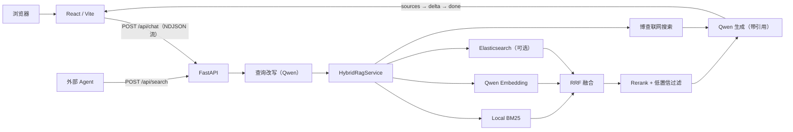

# ClaimWise: **Insurance RAG Assistant**

[](https://github.com/crake7even/claimwise/actions/workflows/ci.yml)
[](https://www.python.org/)
[](https://react.dev/)
[](LICENSE)

> 保险资料智能问答系统

一个面向保险文档的混合检索 RAG 项目。系统按条款结构切分文档，融合 BM25 与 Qwen Embedding 召回（RRF），经 Rerank 重排后由 Qwen 流式生成带引用编号的回答，并配有 200 条评测集量化检索与生成质量。

- 在线 Demo：[insurance-rag-frontend.netlify.app](https://insurance-rag-frontend.netlify.app) 
- API 健康检查：[insurance-rag-api-hoz9.onrender.com/api/health](https://insurance-rag-api-hoz9.onrender.com/api/health)
> Render 免费实例可能休眠，首次请求通常需要等待冷启动。

## 项目亮点

- **结构化切分**：按问答块（Q1）、条款（第X条）、章节（责任免除）和释义词条切分，chunk 带文档名与章节前缀。
- **混合召回 + RRF + Rerank**：BM25 与 Qwen Embedding 按排名融合，再由 `qwen3.7-text-rerank` 重排。
- **查询改写与多轮对话**：结合历史补全追问中的指代，并把口语表达转换为条款用语。
- **可追溯引用**：回答逐条标注 `[n]`，前端点击即可查看原文片段与章节；联网结果附原文链接。
- **低置信拒答**：Rerank 相关度低于阈值的片段不提供给模型，库外问题直接说明资料不足。
- **评测驱动**：200 条评测集（dev / holdout），检索指标离线可跑，生成质量由 LLM-judge 打分。
- **降级可用**：模型或外部服务不可用时返回检索摘要；文档加载失败在 `/api/health` 中可见。

## 架构



## 检索模式

| 界面模式 | 内部值 | 检索策略 |
|---|---|---|
| 快速检索 | `quick` | BM25 → Rerank（多轮追问时启用查询改写） |
| 语义理解 | `semantic` | 查询改写 + BM25 + Embedding → RRF → Rerank |
| 联网搜索 | `web` | 语义理解 + 博查联网搜索 |

## 接口

| 接口 | 说明 |
|---|---|
| `POST /api/chat` | 请求 `{message, mode, history}`；返回 NDJSON 事件流：`sources`（编号引用列表）→ `delta`（正文增量）→ `done`，异常时插入 `error` 并降级为检索摘要 |
| `POST /api/search` | 请求 `{query, mode, top_k}`；只检索不生成，返回结构化结果，可作为外部 Agent 的知识库工具 |
| `GET /api/health` | 各模式可用性、chunk 数量及每份文档的加载状态 |

## 快速开始

### 1. 后端

macOS / Linux：

```bash
git clone https://github.com/crake7even/claimwise.git
cd claimwise
python3 -m venv backend/.venv
backend/.venv/bin/python -m pip install -r backend/requirements.txt
cp backend/.env.example backend/.env
cd backend && .venv/bin/python -m uvicorn api_server:app --host 127.0.0.1 --port 7870
```

Windows PowerShell：

```powershell
git clone https://github.com/crake7even/claimwise.git
cd claimwise

py -3.11 -m venv backend\.venv
backend\.venv\Scripts\python.exe -m pip install -r backend\requirements.txt
Copy-Item backend\.env.example backend\.env

cd backend
.\.venv\Scripts\python.exe -m uvicorn api_server:app --host 127.0.0.1 --port 7870
```

API 文档：`http://127.0.0.1:7870/docs`

健康检查：`http://127.0.0.1:7870/api/health`

### 2. 前端

另开一个 PowerShell：

```powershell
cd claimwise\frontend
npm ci
npm run dev
```

访问 `http://127.0.0.1:3000/`。本地开发时，Vite 会将 `/api` 代理到 `http://127.0.0.1:7870`。

## 配置

后端配置模板位于 [`backend/.env.example`](backend/.env.example)。

| 配置 | 作用 | 是否必需 |
|---|---|---|
| `DASHSCOPE_API_KEY` | Qwen 生成、Embedding、Rerank、查询改写（[阿里云百炼](https://bailian.console.aliyun.com/)） | 否，缺失时降级为本地 BM25 检索摘要 |
| `QWEN_CHAT_MODEL` | 生成模型，默认 `qwen3.6-flash`（关闭思考模式） | 否 |
| `RERANK_MIN_SCORE` | 低置信拒答阈值，默认 `0.5`（依据评测集库外题分布） | 否 |
| `RAG_CHUNK_STRATEGY` / `RAG_CHUNK_SIZE` | 切分策略与小节最大长度，默认 `structured` / `400` | 否 |
| `BOCHA_API_KEY` | 博查联网搜索（[open.bochaai.com](https://open.bochaai.com/)） | 否 |
| `ENABLE_ES` / `ES_HOST` / `ES_PASSWORD` | 可选的 Elasticsearch 召回，索引由 `scripts/index_es.py` 离线构建 | 否 |
| `ALLOWED_ORIGINS` | 允许访问 API 的前端来源 | 部署时必须配置 |
| `VITE_API_BASE_URL` | 前端的线上 API 地址 | 前端部署时必须配置 |

真实 API Key、Token 和密码只能放入本地 `.env` 或部署平台 Secret，不要写入前端代码、日志或 Git 历史。

## 测试与验证

```powershell
cd backend
.\.venv\Scripts\python.exe -m unittest discover -s tests -v

cd ..\frontend
npm run lint
npm run build
```

后端测试会禁用 ES、Embedding、Rerank 和联网搜索，覆盖文档加载、结构化切分、RRF、流式事件协议和降级路径，因此在 GitHub Actions 中不需要任何密钥。

## 评测

评测集位于 [`backend/eval/dataset.jsonl`](backend/eval/dataset.jsonl)：200 条样本，覆盖 12 份文档，分为事实、口语改写、对比、流程、库外五类，dev 160 / holdout 40。每条样本以"文件 + 关键词"标注依据，与切分方式解耦。

```bash
cd backend
.venv/bin/python eval/validate_dataset.py                 # 校验标注能在 chunk 中命中
.venv/bin/python eval/run_eval.py                         # 检索评测（离线，BM25）
.venv/bin/python eval/run_eval.py --online --mode full    # 检索评测（改写 + Embedding + Rerank）
.venv/bin/python eval/run_judge.py --mode semantic        # 生成质量（LLM-judge）
```

### 结果

检索（dev 136 题 / holdout 34 题，库外题不计入；Recall@3000字 = 按排名截取 3000 字上下文时是否包含答案）：

| 配置 | Hit@1 | Recall@3000字 | MRR@10 |
|---|---|---|---|
| 改造前：1200 字定长切分 + 分数直接相加 | 0.610 | 0.757 | 0.716 |
| 结构化切分 + 分词修复 + RRF | 0.713 | 0.963 | 0.812 |
| + Rerank | 0.882 | 0.985 | 0.937 |
| + 查询改写（线上 `semantic` 模式） | 0.868 | 0.985 | 0.926 |
| 线上 `semantic` 模式 · holdout | 0.941 | 1.000 | 0.966 |

生成质量（`qwen3.6-flash` 生成，`qwen3.8-max` 裁判）：

| 版本 | 关键点覆盖率 | 忠实度 | 误拒率 | 库外处理准确率 |
|---|---|---|---|---|
| 改造前 · dev | 0.887 | 0.612 | 0.030 | 0.958 |
| 当前 · dev | 0.919 | 0.941 | 0.007 | 1.000 |
| 当前 · holdout | 0.879 | 0.971 | 0.029 | 1.000 |

完整报告见 [`backend/eval/reports/`](backend/eval/reports/)。

## 目录结构

```text
claimwise/
├─ backend/
│  ├─ api_server.py          # FastAPI 入口
│  ├─ rag_upgrade/           # 文档切分与混合检索
│  ├─ docs/                  # 演示知识库
│  ├─ eval/                  # 评测集、检索评测、LLM-judge 与报告
│  ├─ scripts/               # ES 索引、Embedding 预计算
│  └─ tests/                 # 离线单元测试
├─ frontend/                      # React / Vite 聊天工作台
├─ docs/                          # 产品 Spec 与设计资料
├─ .github/workflows/             # 持续集成
└─ render.yaml                    # Render 后端部署配置
```

## 设计取舍与已知限制

- 会话历史仅保存在当前浏览器 `localStorage`，不做账号和云同步。
- 扫描件 PDF（如亚马逊责任险条款）无法抽取文本，加载时跳过并在 `/api/health` 中报告，尚未接入 OCR。
- 评测集由 LLM 辅助起草、按原文校验定位关键词，关键点未经保险专业人员逐条审核。
- 引用定位到章节 / 条款级，未提供 PDF 页码。
- 公开 Demo 没有用户账号和持久化服务端会话，也不应在问题中输入身份证号、保单号等敏感信息。
- 公开 API 目前未提供用户级配额和分布式限流，生产化时需在网关或平台层增加保护。

## 声明

本项目仅用于 RAG 工程学习和技术演示。AI 生成内容及仓库中的示例资料不构成承保、理赔、法律或投资建议。

## License

[MIT](LICENSE)
